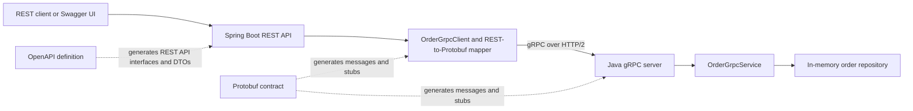

# Order Management REST and gRPC Services

A modular order-management application with a Spring Boot REST API and a separate Java gRPC service. The REST API exposes an HTTP/JSON contract defined in OpenAPI and delegates order operations to the gRPC service through Protocol Buffers. The service implements unary, server-streaming, client-streaming, and bidirectional-streaming RPCs.

The codebase uses contract-first APIs, focused Maven modules, centralized error translation, configurable service addresses, reusable gRPC observer helpers, automated tests, and non-root container images. It is a reference implementation rather than a production deployment: order data is held in memory, and the gRPC connection uses plaintext without authentication.

## Capabilities

- Defines the gRPC service and messages in `.proto` files and generates Java messages and stubs.
- Exposes an OpenAPI-defined HTTP/JSON API backed by gRPC calls.
- Implements all four gRPC interaction patterns for order operations.
- Translates application exceptions to gRPC statuses and back to domain exceptions, then maps failures to HTTP responses.
- Separates contracts, transport utilities, applications, and test support across Maven modules.
- Builds and runs both services with multi-stage Dockerfiles and Docker Compose.

## Architecture



The REST API and gRPC server run as separate processes and containers. In Compose, the REST API connects to the server using the Compose service name `grpc-server` on port `9090`; it does not use `localhost` to reach the other container.

### Maven modules

| Module | Responsibility |
| --- | --- |
| `order-contract` | Protobuf definitions and generated gRPC messages and stubs. |
| `order-common` | Shared application exceptions and the domain-exception/gRPC-status mapper. |
| `order-grpc-support` | Reusable gRPC response sender and receiver helpers for unary and streaming observer interactions. |
| `order-grpc-test-support` | Reusable observers, test services, and JUnit support for gRPC tests. |
| `order-grpc-server` | Plain Java gRPC server, order service, server configuration, and in-memory repository. |
| `order-rest-api` | Spring Boot HTTP API, generated OpenAPI models/interfaces, gRPC client, REST-to-gRPC mapping, and HTTP exception handling. |

## Technologies

| Technology | Use in this project |
| --- | --- |
| Java 25 | Application and generated Java sources. |
| Maven 3.9+ | Multi-module build, code generation, tests, and packaging. |
| Spring Boot 3.5.14 | REST API, configuration, and HTTP exception handling. |
| gRPC Java 1.80.0 | RPC server, blocking and asynchronous clients, channels, and status handling. |
| Protocol Buffers 3.25.9 | Language-neutral gRPC messages and service contract. |
| OpenAPI 3.0 | REST contract in `order-rest-api/src/main/resources/openapi/order-api.yaml`. |
| OpenAPI Generator 7.22.0 and Springdoc 2.8.17 | Generate REST interfaces/models and expose Swagger UI and API docs. |
| JUnit 5, AssertJ, Mockito | Unit, gRPC, and Spring MVC slice tests. |
| JaCoCo | Test coverage reports; generated protobuf and OpenAPI code is excluded. |
| Docker BuildKit and Compose | Multi-stage image builds and local multi-container execution. |
| SapMachine 25 JRE | Java runtime base image for both application containers. |

The gRPC server also registers the standard gRPC health service and reflection service. Reflection is useful for tools that inspect a running gRPC server; it does not replace the protobuf contract in source control.

## Requirements

For a local Maven build, install:

- JDK 25 or later.
- Maven 3.9.0 or later.

For the container setup, install Docker with BuildKit and the Docker Compose v2 plugin. The Dockerfiles use a BuildKit cache mount for the Maven repository.

## Build and test

Run from the repository root:

```bash
mvn clean verify
```

This builds the Maven reactor, generates Java from the protobuf and OpenAPI contracts, runs the tests, and creates JaCoCo reports during `verify`. Reports are written under each module's `target/site/jacoco/` directory.

The tests include direct gRPC service/client tests, in-process gRPC test support, REST controller tests using Spring MVC's test framework, and focused tests for configuration, mapping, and exception handling. Generated contract classes are not included in coverage results.

Docker image builds use `-DskipTests`; run `mvn clean verify` separately to execute the test suite before building or publishing images.

## Run with Docker Compose

From the repository root, build the images and start both services:

```bash
docker compose up --build -d
```

Check the containers and logs:

```bash
docker compose ps
docker compose logs -f grpc-server rest-api
```

The REST API is published on `http://localhost:8080`; the gRPC server is published on port `9090`. Open Swagger UI at:

```text
http://localhost:8080/swagger-ui.html
```

The OpenAPI document is available at `http://localhost:8080/v3/api-docs`.

To stop the services:

```bash
docker compose down
```

Orders live only in the gRPC server's memory. Stopping or recreating that container clears the orders. Start from a clean store with `docker compose down` followed by `docker compose up --build -d`. `docker compose restart` restarts existing containers but does not rebuild an image after a code change.

### Configuration

The Compose file provides these environment variables; none of the service addresses are baked into the application Dockerfiles.

| Variable | Used by | Default | Compose value |
| --- | --- | --- | --- |
| `SERVER_PORT` | REST API (Spring Boot) | `8080` | `8080` |
| `GRPC_ORDER_SERVICE_HOST` | REST API gRPC client | `localhost` | `grpc-server` |
| `GRPC_ORDER_SERVICE_PORT` | REST API gRPC client | `9090` | `9090` |
| `GRPC_SERVER_PORT` | gRPC server | `9090` | `9090` |

When running the applications directly on your machine, start the gRPC server first, then the REST API. Set `GRPC_ORDER_SERVICE_HOST=localhost` for the REST API in that setup. Within Compose, use `grpc-server`, which Docker resolves through its internal network DNS.

For IDE run configurations, import the root `pom.xml` as a Maven project, then run these main classes in separate processes:

1. `com.example.OrderGrpcServerApplication` with `GRPC_SERVER_PORT=9090`.
2. `com.example.OrderRestApplication` with `SERVER_PORT=8080`, `GRPC_ORDER_SERVICE_HOST=localhost`, and `GRPC_ORDER_SERVICE_PORT=9090`.

## REST endpoints and example requests

All examples use `http://localhost:8080`. Swagger UI provides the same contract and lets you execute requests in the browser.

| gRPC RPC | Call type | REST endpoint |
| --- | --- | --- |
| `CreateOrder`, `GetOrder`, `ListOrders` | Unary | `POST /orders`, `GET /orders/{orderId}`, `GET /orders` |
| `TrackOrder` | Server streaming | `GET /orders/{orderId}/tracking` |
| `CalculateQuote` | Client streaming | `POST /orders/quote` |
| `LiveTracking` | Bidirectional streaming | `POST /orders/{orderId}/live-tracking` |

### Server information

`GET /server-info`

```bash
curl http://localhost:8080/server-info
```

Example response:

```json
{
  "name": "Order REST API",
  "version": "1.0.0",
  "status": "UP"
}
```

This response reports fixed application metadata; it is not a dependency-aware readiness check.

### List orders

`GET /orders`

```bash
curl http://localhost:8080/orders
```

An empty store returns `[]`.

### Create an order — unary RPC

`POST /orders` maps to the unary `CreateOrder` RPC: one REST request becomes one gRPC request and response.

```bash
curl --request POST http://localhost:8080/orders \
  --header 'Content-Type: application/json' \
  --data '{
    "customerName": "Ada Lovelace",
    "address": "123 Sofia Blvd",
    "items": [
      {
        "productId": "P-100",
        "name": "Keyboard",
        "quantity": 2,
        "price": 49.99
      }
    ]
  }'
```

Success returns HTTP `201 Created` with a generated order ID:

```json
{
  "orderId": "<generated-order-id>",
  "status": "CREATED"
}
```

Use the returned ID in the following examples.

### Get one order — unary RPC

`GET /orders/{orderId}` maps to `GetOrder`.

```bash
ORDER_ID='paste-the-order-id-returned-by-create'
curl "http://localhost:8080/orders/${ORDER_ID}"
```

The response includes the customer, address, status, and items. An unknown ID returns HTTP `404`.

Example response shape:

```json
{
  "orderId": "<generated-order-id>",
  "customerName": "Ada Lovelace",
  "address": "123 Sofia Blvd",
  "status": "CREATED",
  "items": [
    {
      "productId": "P-100",
      "name": "Keyboard",
      "quantity": 2,
      "price": 49.99
    }
  ]
}
```

### Get tracking history — server-streaming RPC

`GET /orders/{orderId}/tracking` maps to `TrackOrder`: one request produces a stream of tracking events. The REST facade collects the gRPC events into a JSON array.

```bash
ORDER_ID='paste-the-order-id-returned-by-create'
curl "http://localhost:8080/orders/${ORDER_ID}/tracking"
```

For a created order, events progress through `CREATED`, `PREPARING`, and `ON_THE_WAY`. Each event has a Unix timestamp in milliseconds.

The REST response is an array, for example:

```json
[{
  "orderId": "<generated-order-id>",
  "status": "CREATED",
  "message": "Order received",
  "timestamp": 1793134905586
}]
```

### Calculate a delivery quote — client-streaming RPC

`POST /orders/quote` maps to `CalculateQuote`: the REST request contains a list of quote items, which the client sends as multiple gRPC requests before receiving one response.

```bash
curl --request POST http://localhost:8080/orders/quote \
  --header 'Content-Type: application/json' \
  --data '[
    {
      "productId": "P-100",
      "quantity": 2,
      "weight": 1.5
    }
  ]'
```

Example response:

```json
{
  "deliveryPrice": 8.75,
  "estimatedDeliveryTimeMinutes": 33
}
```

The quote calculation uses total weight (`quantity × unit weight`), a base delivery price of `5.00`, a per-weight price of `1.25`, and a base estimate of 30 minutes plus the ceiling of total weight.

### Send driver commands — bidirectional-streaming RPC

`POST /orders/{orderId}/live-tracking` maps to `LiveTracking`: the client sends a sequence of commands while the gRPC server responds with a sequence of events. The REST facade returns the events as a JSON array.

```bash
ORDER_ID='paste-the-order-id-returned-by-create'
curl --request POST "http://localhost:8080/orders/${ORDER_ID}/live-tracking" \
  --header 'Content-Type: application/json' \
  --data '[
    {"command": "ACCEPT_ORDER"},
    {"command": "PICK_UP_ORDER"},
    {"command": "START_DELIVERY"},
    {"command": "COMPLETE_DELIVERY"}
  ]'
```

The response events progress through `PREPARING`, `PICKED_UP`, `ON_THE_WAY`, and `DELIVERED`. The commands generate tracking events; they do not persist a new order status in the repository.

### Quick validation and error examples

- A request that violates the OpenAPI/Jakarta validation rules returns HTTP `400` with field names and constraint messages.
- A customer name of two spaces passes the OpenAPI minimum-length rule but is rejected by the gRPC server with `Customer name is required`.
- A quote item with `"productId": " "` passes the minimum-length rule but is rejected by gRPC with `product id is required`. Keep the other quote fields valid.
- An unknown command such as `[{"command":"NOT_A_COMMAND"}]` cannot be deserialized to the generated enum and returns HTTP `400` with a safe malformed/unsupported request message.
- An unknown order ID returns HTTP `404`.

## Error handling design

The server maps known application exception types to gRPC status codes and includes a known error name in gRPC metadata. The REST-side client maps recognized status/error-name pairs back to application exceptions. The order-specific REST advice returns the associated domain message for these known business errors. Unknown or internal failures use generic public messages so implementation details are not returned to callers.

The global REST handler also maps gRPC status codes to HTTP status codes, for example `INVALID_ARGUMENT` to `400`, `NOT_FOUND` to `404`, `UNAVAILABLE` to `503`, and `DEADLINE_EXCEEDED` to `504`. Request validation errors include field-level information; malformed JSON and unknown enum values receive a safe `400` response.

`GrpcResponseSender` centralizes server-side observer completion and exception mapping. `GrpcResponseReceiver` centralizes client-side response collection, exception mapping, and timeouts for asynchronous streaming calls. This keeps the service and client methods focused on their RPC-specific work.

## Docker image design

Each application has a multi-stage Dockerfile:

1. A Maven and Eclipse Temurin 25 build stage compiles the selected application and its reactor dependencies.
2. A BuildKit cache mount reuses downloaded Maven artifacts between builds.
3. A SapMachine 25 headless JRE Ubuntu runtime stage contains only the packaged application and its runtime dependencies.
4. The application runs as the unprivileged UID/GID `10001:10001`.

The gRPC server image copies its dependency JARs to `/app/lib`; the REST API uses its Spring Boot executable JAR. Ports and service addresses are set at container startup through Compose environment variables. The repository's `.dockerignore` keeps IDE files, build outputs, Git metadata, logs, and local environment files out of the Docker build context.

Compose builds local images named `grpc-rest-demo/order-grpc-server:local` and `grpc-rest-demo/order-rest-api:local`. To build and publish multi-platform images, replace the example registry and owner with your own values and run from the repository root:

```bash
docker buildx build --platform linux/amd64,linux/arm64 \
  --file order-grpc-server/Dockerfile \
  --tag ghcr.io/your-owner/grpc-rest-demo-order-grpc-server:1.0.0 \
  --push .

docker buildx build --platform linux/amd64,linux/arm64 \
  --file order-rest-api/Dockerfile \
  --tag ghcr.io/your-owner/grpc-rest-demo-order-rest-api:1.0.0 \
  --push .
```

Multi-platform manifests are normally pushed to a registry. Compose's local build is the simplest way to run the images for the current machine architecture.

## Scope and next steps

The order domain is deliberately narrow, with clear boundaries between the REST API, gRPC contract, and service implementation. Production deployment would require durable storage, transport security and authentication, readiness checks wired into deployment, metrics/tracing, and retry policies appropriate to each operation. The gRPC server currently uses an in-memory `ConcurrentHashMap`, plaintext transport, and fixed quote and tracking behavior. Compose's `depends_on` orders service startup but does not wait for the gRPC health service to report ready.

Potential follow-on work includes persistence, authorization, deadlines and cancellation behavior, gRPC metadata propagation, health-aware Compose orchestration, and tests for service-to-service failure scenarios.
